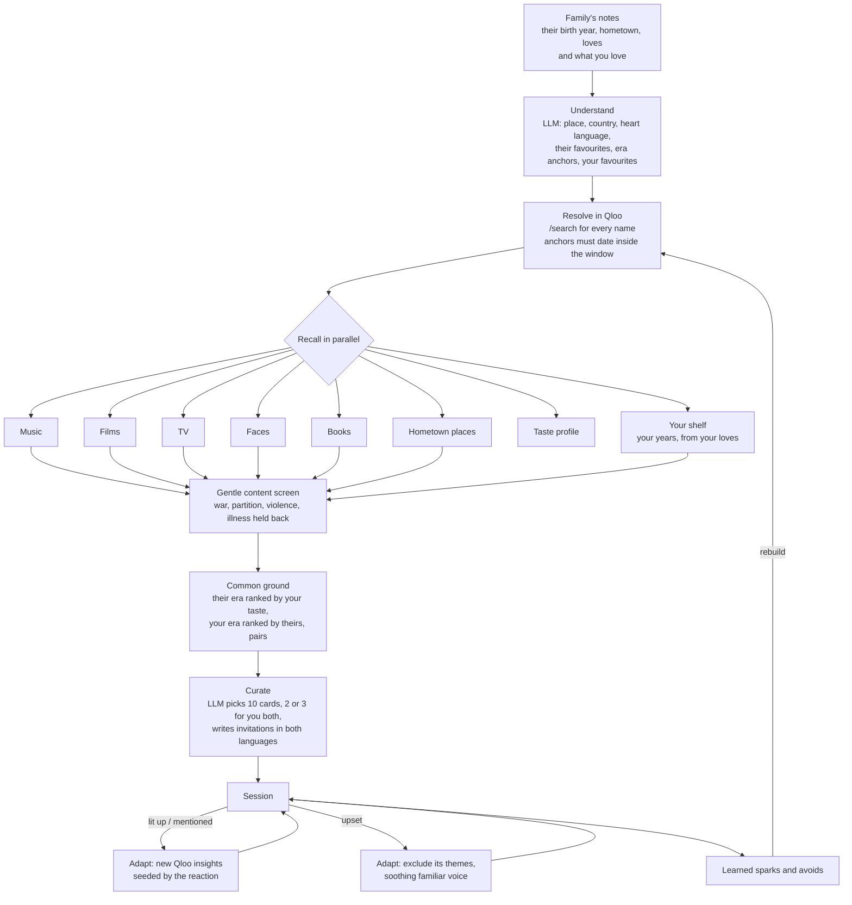

# Duet

**Two eras, one song.** Duet is an agent for families living with dementia. It finds the music, films and food of a loved one's youth, then finds where *your* taste meets *theirs*, so a reminiscence session becomes something you share instead of something you run.

Tell it a little about the person: the year they were born, where they grew up, a few things they loved. Then name a few things you love yourself. Duet uses Qloo's taste graph to rebuild the world they lived in between the ages of 10 and 30, ranks that world by your taste and your own era by theirs, and pairs each of your favourites with one of theirs. It turns all of it into a gentle 10-card session in their heart language, with a few cards chosen for you both. Every smile, silence or tear changes what comes next, and afterwards it prints a care card any carer can pick up.

- **Live demo:** https://duet-ruddy-ten.vercel.app
- Built for the [Qloo LLM Hackathon](https://qloo.devpost.com/) ("Agents, but with taste")
- MIT licensed

## Why

More than 55 million people live with dementia. Two things stay true for most of them for a long time:

1. **The reminiscence bump.** People recall far more from roughly ages 10 to 30 than from any other stretch of life.
2. **Music memory holds on.** Familiar songs from those years often reach people when names and faces no longer do.

Reminiscence work is a widely recommended, drug-free way to use this, and it can be done at a kitchen table. The hard part is that the person sitting at that table is often a grandchild who was born fifty years later. They do not know what played on the radio in Lucknow in 1968, and a generic "oldies" playlist gets the era and the country wrong. Without an era lock, "Hindi film music" for a woman born in 1951 drifts to singers like Sonu Nigam, who was born in 1973.

Even with the right era, a session where one person performs memories for the other wears thin. What families say they want is something to *share*. So Duet asks the grandchild what they love too, and lets Qloo find the bridge:

| You love | They love | What Qloo says |
| --- | --- | --- |
| Arijit Singh (b. 1987) | Mohammed Rafi (b. 1924) | Rafi is among Arijit Singh's influences. Hindi, playback singing. |
| Christian Nodal (b. 1999) | Vicente Fernández (b. 1940) | Vicente Fernández is among Nodal's influences. Ranchera, mariachi. |
| Harry Styles (b. 1994) | The Beatles | The Beatles are among Harry Styles's influences. |
| *La La Land* (2016) | *Roman Holiday* (1953) | Her favourite film, high on her era's list when Qloo ranks it by your taste. Romance, nostalgic. |

## What it does

| Screen | What happens |
| --- | --- |
| **Memory map** (`/p/:id`) | The agent builds shelves of songs, films, TV, faces and books from the person's own years, plus a "Taste of" their hometown with traditional dishes and old landmarks. Items show their year and how old the person was then. The build streams live, step by step, with the exact Qloo requests behind each shelf. |
| **Common ground** | Pairs of your favourites and theirs, each with the Qloo tags they share and, where Qloo has one, the "influenced by" link between them. Below: *from their years, for you* (their era ranked by your taste) and *from your years, for them* (your era ranked by theirs). Add or change what you love inline and the map rebuilds. |
| **Session** (`/p/:id/session`) | A full-screen, low-glare deck. Each card has an invitation to say out loud (never a quiz), the same line in their heart language, read-aloud, a playable Spotify embed for artists and a one-line cue for the carer. Up to three cards are marked **For you both**. Four big buttons: **Lit up, Calm, No response, Upset**. A note box or voice note captures what they said. |
| **Live adaptation** | *Lit up* asks Qloo for what sits closest to that item, in the same domain and across domains, and slots the new cards in next. Anything they mention by name ("she sang *Chaudhvin Ka Chand*") is resolved in Qloo and becomes the strongest signal. *Upset* sets the item and its themes aside and moves straight to a soothing familiar voice with no questions. **Calm now** does that at any moment. |
| **Learning** | Sparks and things to avoid persist. "Rebuild with what we learned" re-runs the agent with sparks as new Qloo seeds and upsetting items excluded. |
| **Care card** (`/p/:id/care-card`) | A printable page: what lights them up, what to do when they are upset, what to avoid, conversation starters that worked, their own words, common ground with family, and the taste of home. |

Three ready-made families are on the landing page: Kamla (Lucknow, 1951) with a grandchild who loves Arijit Singh; Dorothy (Memphis, 1942) with one who loves Taylor Swift; Ramón (Guadalajara, 1946) with one who loves Christian Nodal.

## How the agent works



### Every Qloo call, and why

All calls go to `https://hackathon.api.qloo.com` from the server ([`lib/qloo.ts`](lib/qloo.ts)). The key never reaches the browser.

| Step | Request | Purpose |
| --- | --- | --- |
| Resolve | `GET /search?query=…&types=urn:entity:artist` (and movie, tv_show, book, person) | Turn "she loved Rafi and *Guide*" into Qloo entities. LLM-suggested era anchors are kept only if Qloo dates them inside the person's window, so a hallucinated or wrong-decade match is dropped. Your own loves are searched across artists, films and shows at once, and Qloo's popularity settles which "Coco" you meant. |
| Music | `GET /v2/insights?filter.type=urn:entity:artist&signal.interests.entities=…&feature.explainability=true&take=50` | Artists close to their known loves. Artist results are then era-checked against Qloo's own `start_year` and `date_of_birth` properties, so a singer who started after they turned 24 is dropped. Decade tags (`urn:tag:genre:60s`) are added as a signal only when there are fewer than two seeds. |
| Films | Same, `filter.type=urn:entity:movie` with `filter.release_year.min/max`, run twice: once with `filter.release_country` set to their home country and once without | Home-country cinema first, then the graph's wider picks fill any gap. Common ground uses only the home-country films when there are enough of them. |
| TV | `filter.type=urn:entity:tv_show`, release years and `filter.release_country` | Hidden when Qloo has nothing for that country and decade (India in the 1960s and 70s, for example), rather than filled with someone else's television. |
| Faces | `filter.type=urn:entity:person`, `filter.date_of_birth.min/max` | Stars who were famous while they were young, not stars who were born after them. |
| Books | `filter.type=urn:entity:book`, `filter.publication_year.min/max` | |
| Taste of home | `filter.type=urn:entity:place&filter.location.query=<hometown>&filter.tags=urn:tag:genre:place:restaurant&take=30` | Specialty dish, menu highlight, cuisine and nearby attraction tags are aggregated across thirty places into the dishes the town is known for and the streets and landmarks around them. Modern places and generic dishes are filtered out, and dishes from the local and heritage cuisines are weighted up. |
| Taste profile | `filter.type=urn:tag&filter.parents.types=urn:entity:artist,urn:entity:movie` | The tags that describe their taste ("Devotion", "Romance", "Warm Toned"), shown on the map. |
| Your shelf | Artist and film insights seeded with your favourites, films limited to your own formative years | The other half of the duet. Qloo's graph rarely jumps fifty years from an elder's taste on its own, so this side starts from the younger taste. |
| Rank both ways | `filter.type=…&signal.interests.entities=<one side>&filter.results.entities=<the other side's shelf>` | Qloo scores a fixed list against a taste. Their era (their loves, the verified anchors and their shelves) is ranked by your favourites; your shelf is ranked by theirs. This is where "Kishore Kumar comes out closest to your Arijit Singh" comes from. |
| Pairs | The same ranking, once per favourite of yours, plus Qloo's `urn:tag:influenced_by:*` tags | Each favourite of yours is paired with the nearest of theirs. Where Qloo lists theirs among your favourite's influences, that link wins. Shared genre, theme and keyword tags, weighted by how rare they are across both shelves, label the pair. |
| Lit up | Two insights calls (same kind and a cross-domain kind) seeded with the item, anything they mentioned and recent sparks, with `filter.exclude.entities` for everything already shown and `feature.explainability=true` | "She lit up at Kishore Kumar, so Qloo brings in *Padosan*, where he starred." Explainability is what lets each new card say which of their loves it came from. |
| Upset | `filter.exclude.tags` for the item's sad tags (tragedy, loss, war…) on every later live query | Distress shapes the requests that follow it. The soothing pick itself comes from the already-built music shelf, so there is no wait. |
| Rebuild | Sparks become `signal.interests.entities`, upset items become `filter.exclude.entities` | The second map is built from what actually worked. |

A full build with common ground is about 30 Qloo requests (most of them searches and fast ranking calls) and two LLM calls, and takes around 12 seconds. The map page's "How the agent built this" section lists each step, its timing and the exact request.

### Where the LLM fits

The LLM (Groq, `openai/gpt-oss-120b` with fallbacks) does language work only: read the family's notes, suggest era anchors to look up, choose and order ten cards from the Qloo candidates, and write the invitations. It is given short ids for candidates and the cards are mapped back to Qloo entities, so it cannot invent an item. The year and age chips, the "why this card" line and every common-ground claim are computed from Qloo data, not written by the model. Voice notes are transcribed with Whisper.

## Care principles built in

- **Invitations, not tests.** Prompts are what you say to the person, in the second person, and never "Do you remember…?". "Tell me about the cinema where you watched *Guide*" instead.
- **Gentle content screen.** Items about war, partition, violence, illness or loss are held back unless the family raises them, and the trace shows what was held back and why. The same screen applies to your own loves before they shape the session.
- **Heart language.** Each prompt also appears in the person's first language and script, and can be read aloud slowly.
- **No response is fine.** The deck simply moves on.
- **Calm now** is always one tap away.

Duet is a conversation aid, not a medical device or a substitute for professional care.

## Privacy

- Names never leave the device. People, maps, sessions and notes live in the browser's `localStorage`; there is no database and no account.
- The server receives birth years, the hometown, the free-text notes, what you love and reactions. Qloo receives only cultural entity names and ids, years, the hometown and country, never personal details.
- The free-text notes are sent to Groq for the language steps.
- Qloo responses are cached on the server for a week to stay inside rate limits. They are never written to this repository.

## Run it locally

Requires Node 20+.

```bash
cp .env.example .env
```

Fill in `QLOO_API_KEY` and `GROQ_KEY`, then:

```bash
npm install
```

```bash
npm run dev
```

Open http://localhost:3000 and pick Kamla, Dorothy or Ramón.

## Deploy

Any Node host that runs Next.js works. On Vercel: import the repository, add `QLOO_API_KEY` and `GROQ_KEY` as environment variables, and deploy. The build route streams for up to 60 seconds.

## Project layout

```
app/
  page.tsx                 landing page
  new/                     add a person (and what you love)
  p/[id]/                  memory map, session, care card
  api/build/               streams the agent's build as NDJSON
  api/adapt/               live adaptation after a reaction
  api/transcribe/          voice notes (Whisper)
lib/
  build.ts                 the build pipeline
  together.ts              common ground: your shelf, ranking both ways, pairs
  adapt.ts                 mid-session adaptation
  qloo.ts                  Qloo client (server only)
  era.ts                   reminiscence window, era checks, content screen
  groq.ts                  LLM and Whisper client
  store.ts                 on-device storage
components/                common ground, shelves, trace, posters, voice button
```

## Known limits

- Coverage varies by country and decade. Thin shelves are hidden rather than padded with the wrong era.
- Place data reflects restaurants that exist today, so "Taste of home" leans on dishes and landmarks rather than the restaurants themselves.
- Qloo's ranking is relative: the top of their era for your taste is a good place to start a conversation, not a promise you will love it.
- The model's translations are good but not perfect; the English line is always shown alongside.
- Spotify embeds appear when Qloo has a Spotify id for the artist; otherwise there is a YouTube search link.

## License

[MIT](LICENSE)
